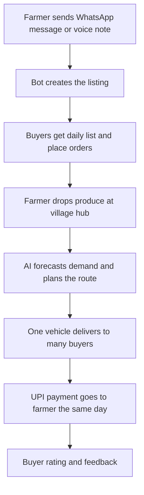

# Smart India Hackathon Workshop
# Date:30.10.26
## Reference Number:26013088
## Name:KASI VISWANATH SAH KB

## Problem Title
SIH 26033: Multiple intermediaries reduce farmers earnings and increase consumer prices.

## Problem Creater's Organization
Ministry of Consumer Affairs, Food & Public Distribution

## Theme
Agriculture, FoodTech & Rural Development

## Problem Description
Expected Solution: Create a digital marketplace that:

• Connects farmers/FPOs directly with consumers and bulk buyers.
• Provides logistics support.
• Uses AI for demand forecasting and route optimization.

Benefits:

• Better prices for farmers.
• Lower prices for consumers.
• Reduced supply chain inefficiencies.

## Proposed Solution

**Our idea: Santhai on WhatsApp**, a simple marketplace that works inside WhatsApp and SMS, so a farmer does not need to download or learn any new app.

**1. How it works**
- A farmer sends a message or a voice note to our WhatsApp number: *"Tomato, 200 kg, tomorrow."* Our bot understands it and creates the listing.
- Nearby buyers (families in apartment groups, hotels, small shops) get a daily list of fresh produce with the farmer's price and pick one with a tap.
- Each village or FPO has one **collection hub** (a small shed or shop). Farmers drop their produce there, and one vehicle picks up from the hub and delivers to buyers in a single trip.
- Payment goes through UPI. The farmer's share reaches their account the same day the produce is delivered.

**2. How it solves the problem**
Middlemen exist because farmers cannot reach buyers and cannot afford transport alone. WhatsApp solves the reach problem, because farmers already use it. Collection hubs solve the transport problem, because the cost is shared among many farmers. The result is that fewer hands touch the produce, the farmer keeps a bigger share, and the buyer pays less.

**3. What makes it different**
- **No new app to install:** works where farmers and buyers already are.
- **Voice-first:** a farmer can list by speaking in Tamil, Hindi or any local language.
- **Hub-based delivery:** one trip serves many farmers, which keeps logistics cheap.
- **Simple AI that actually helps:** a daily message to the farmer like "Tomato demand is high in your area this week, price around ₹X/kg is likely to sell."
- **Works on poor networks:** SMS fallback for farmers without good internet.

## Technical Approach

**1. Technologies to be used**

| Layer | Technology |
|---|---|
| Farmer and buyer interface | WhatsApp Business Cloud API, SMS gateway |
| Voice to text | Google Speech-to-Text / Bhashini API |
| Backend | Python (FastAPI) |
| Database | Firebase / PostgreSQL |
| Demand and price forecasting | Python, Prophet / scikit-learn |
| Route optimization | Google OR-Tools with Maps API |
| Admin dashboard (hub and FPO managers) | React.js |
| Payments | UPI / Razorpay |
| Data sources | Agmarknet, e-NAM, data.gov.in mandi prices |

**2. Methodology and process for implementation**

Steps we will follow while building:
1. Talk to a few farmers and an FPO to understand how they sell today.
2. Build the WhatsApp bot for listing and ordering.
3. Set up one pilot hub and connect it to the dashboard.
4. Add price and demand suggestions using mandi data.
5. Add route planning for hub deliveries.
6. Test in one village with a few crops, then improve.

*(Prototype / screenshots / demo link: add here)*

## Feasibility and Viability

**1. Feasibility**
- WhatsApp, UPI and voice input are already part of daily life in most villages.
- We need no heavy infrastructure. A hub can be an existing shop or FPO shed.
- The pilot can start in one village with two or three crops.
- Revenue comes from a small commission and a delivery charge, shared between farmer and buyer.

**2. Potential challenges and risks**
- Some farmers may still find even WhatsApp difficult to use.
- Produce may spoil if delivery gets delayed.
- Buyers may not trust the quality of produce they cannot see.
- Hub managers need to be reliable and honest.
- WhatsApp Business API has usage rules and message costs.

**3. Strategies for overcoming these challenges**
- A trained local helper at each hub who can list produce on behalf of farmers who need help.
- Fixed pickup and delivery slots, and starting with produce that lasts longer or is delivered the same day.
- Photos with every listing, a simple grade (A/B), and buyer ratings.
- Hub managers chosen from the FPO, with simple weigh-and-record sheets that the dashboard checks.
- Start with a small message volume, and move to an SMS fallback for basic actions if costs rise.

## Impact and Benefits

**1. Potential impact on the target audience**
- **Farmers and FPOs:** a higher share of the final price, quick payment, and no need to travel to a distant mandi.
- **Consumers:** fresh produce at a fair price, ordered from a chat they already use.
- **Bulk buyers (hotels, shops, institutions):** steady supply from nearby farms, with a clear record of every order.

**2. Benefits of the solution**
- **Social:** digital inclusion for farmers who have never used an online marketplace, and stronger FPOs.
- **Economic:** better farm-gate income, lower consumer price, and shared transport costs.
- **Environmental:** less spoilage, and fewer vehicles on the road because one trip carries produce from many farmers.

## Research and References

1. Agmarknet (Agricultural Marketing Information Network): https://agmarknet.gov.in
2. e-NAM (National Agriculture Market): https://enam.gov.in
3. Open Government Data Platform India, commodity price datasets: https://data.gov.in
4. Bhashini (Indian language technology platform): https://bhashini.gov.in
5. WhatsApp Business Platform documentation: https://developers.facebook.com/docs/whatsapp
6. Google OR-Tools (route optimization): https://developers.google.com/optimization
7. *(Add any research papers, news articles or reports you refer to)*

