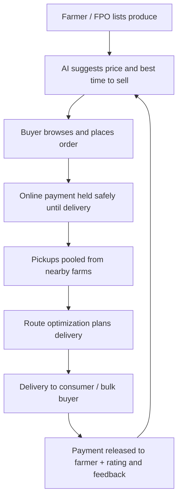

# Smart India Hackathon Workshop
# Date:30.10.26
## Reference Number:26013088
## Name:KASI VISWANATH SAH KB

## Problem Title
SIH 26033: Multiple intermediaries reduce farmers earnings and increase consumer prices.

## Problem Creater's Organization
Ministry of Consumer Affairs, Food & Public Distribution

## Theme
Agriculture, FoodTech & Rural Development

## Problem Description
Expected Solution: Create a digital marketplace that:

• Connects farmers/FPOs directly with consumers and bulk buyers.
• Provides logistics support.
• Uses AI for demand forecasting and route optimization.

Benefits:

• Better prices for farmers.
• Lower prices for consumers.
• Reduced supply chain inefficiencies.

## Proposed Solution

**Our idea: Vayal2Veedu (Field to Home)**, a farmer-first digital marketplace where a farmer or FPO can list their harvest, and a household, a restaurant or a bulk buyer can order it directly, with pickup and delivery taken care of by the platform.

**1. How it works**
- A farmer or FPO lists a crop with quantity, expected price, harvest date and a photo. They can do it by typing or just by speaking in Tamil, Hindi or English.
- Consumers, hotels, retailers and institutional buyers browse, order and pay online. Bulk buyers can place standing orders or ask for a quote.
- Small farmers from the same village or FPO get their produce pooled together, so they can supply bulk orders that one farmer alone could never fulfil.
- Our logistics layer groups nearby pickups, picks the best route and delivers to the buyer. No mandi, no chain of agents in between.
- Every order shows a transparent price breakdown: what the farmer gets, the delivery cost and the platform fee.

**2. How it solves the problem**
Today, produce passes through several hands (commission agents, wholesalers, retailers) and each one adds a margin. The farmer gets a small part of the final price, and the consumer still pays a lot. By connecting both sides directly, we cut out most of those layers. The farmer earns more, the consumer pays less, and less produce rots on the way because it reaches the buyer faster.

**3. What makes it different**
- **AI demand forecasting:** farmers get a suggestion on what to sell, when, and at roughly what price, based on past demand, season and mandi price trends.
- **Route optimization:** pooled pickups and shared delivery routes bring down the logistics cost, which is the main reason direct selling usually fails for small farmers.
- **FPO-first design:** built around groups of farmers, not just individuals, so small farmers can reach bulk buyers.
- **Easy for rural users:** voice-based listing, regional languages, and an SMS/offline fallback for poor connectivity.
- **Price transparency:** everyone can see where the money goes.

## Technical Approach

**1. Technologies to be used**

| Layer | Technology |
|---|---|
| Mobile app (farmers, buyers) | React Native |
| Web dashboard (FPOs, admin) | React.js |
| Backend / APIs | Node.js with Express (or Python FastAPI) |
| Database | PostgreSQL / MongoDB |
| AI/ML (demand and price forecasting) | Python, scikit-learn, Prophet / LSTM |
| Route optimization | Google OR-Tools with Maps API |
| Voice and language support | Speech-to-text APIs, i18n for regional languages |
| Payments | UPI / Razorpay |
| Login | OTP-based authentication |
| Hosting | Cloud (AWS / GCP / Azure) |
| Data sources | Agmarknet, e-NAM, data.gov.in mandi price data |

**2. Methodology and process for implementation**

Steps we will follow while building:
1. Understand the problem: talk to farmers, FPOs and buyers, and study mandi price data.
2. Design the user flows and screens (Figma).
3. Build the core: login, produce listing, ordering and payments.
4. Add the AI models for demand and price forecasting.
5. Add the logistics module with pooled pickup and route optimization.
6. Pilot with a small FPO, collect feedback and improve.

*(Prototype / screenshots / demo link: add here)*

## Feasibility and Viability

**1. Feasibility**
- The building blocks already exist: UPI payments, smartphones in villages, open mandi price data and mapping APIs.
- FPOs are already organised groups, so onboarding many farmers through one FPO is much easier than reaching each farmer separately.
- We can start small with one district and a few crops and then expand.
- Revenue is possible through a small commission, delivery charges and premium services for bulk buyers.

**2. Potential challenges and risks**
- Many farmers are not comfortable with apps.
- Last-mile delivery of perishable produce is costly.
- Quality can vary, and buyers may not trust unseen produce.
- Internet connectivity in villages can be poor.
- Farmers may hesitate to leave their regular agents, especially if they depend on them for credit.

**3. Strategies for overcoming these challenges**
- Voice-based, regional-language interface, plus local "Kisan mitra" helpers or FPO volunteers to onboard people.
- Pooled pickups and route optimization to keep delivery cost low, plus tie-ups with local transport and cold storage.
- Simple quality grading, photos at listing time and a rating system.
- Offline-first features and SMS fallback.
- Start with farmers who are already unhappy with intermediaries and show them the earnings difference, instead of forcing a change on everyone.

## Impact and Benefits

**1. Potential impact on the target audience**
- **Farmers and FPOs:** a better share of the final price, steadier demand and less dependence on middlemen.
- **Consumers:** fresher produce at a lower price, with clear information about where it came from.
- **Bulk buyers (hotels, retailers, institutions):** reliable supply, direct sourcing and predictable pricing.

**2. Benefits of the solution**
- **Social:** stronger rural livelihoods, more bargaining power for small farmers, and digital inclusion in villages.
- **Economic:** higher farm-gate income, lower consumer prices, and fewer inefficiencies in the supply chain.
- **Environmental:** less food wasted on the way to the buyer, and fewer kilometres driven thanks to optimized routes, which means lower fuel use and emissions.

## Research and References

1. Agmarknet (Agricultural Marketing Information Network): https://agmarknet.gov.in
2. e-NAM (National Agriculture Market): https://enam.gov.in
3. Open Government Data Platform India, commodity price datasets: https://data.gov.in
4. Department of Consumer Affairs, Price Monitoring Division: https://consumeraffairs.nic.in
5. Google OR-Tools (route optimization): https://developers.google.com/optimization
6. *(Add any research papers, news articles or reports you refer to)*
